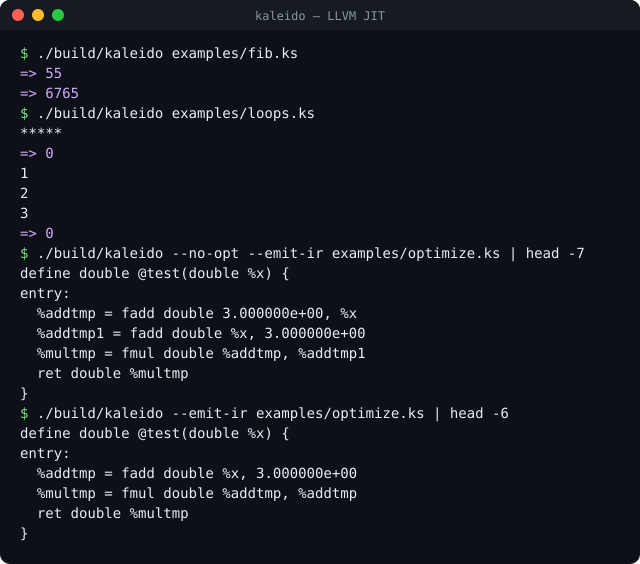

# Kaleidoscope: an LLVM-based JIT compiler in C++

A compiler for **Kaleidoscope**, the small functional language from LLVM's official tutorial. It parses source code into an AST, generates **LLVM IR**, optimizes it with LLVM's pass pipeline, and **JIT-compiles it to native machine code** with ORC LLJIT. I built it following the [LLVM Kaleidoscope tutorial](https://llvm.org/docs/tutorial/MyFirstLanguageFrontend/index.html) (chapters 1–5), updated for LLVM 18 and split into separate lexer, parser, codegen and driver files.

```
def fib(x)
  if x < 3 then 1 else fib(x-1) + fib(x-2);

fib(20);   # => 6765
```



## Features

- **Functions** with any number of `double` arguments, and recursion
- **`extern`** declarations to call C functions from JIT-compiled code (`putchard`, `printd`)
- **`if / then / else`** compiled to basic blocks and a **PHI node**
- **`for` loops** with the loop variable kept in SSA form through a PHI node in the loop header
- Operators `+ - * <` with **operator-precedence parsing**
- **Optimization passes** (new pass manager): InstCombine, Reassociate, GVN, SimplifyCFG
- **JIT execution** with ORC `LLJIT`: function definitions stay loaded, and each top-level expression is compiled in its own module, run, and freed with a `ResourceTracker`

## How it fits together

| Stage | File | What it does |
| --- | --- | --- |
| Lexer | `src/lexer.hpp` | Turns characters into tokens: keywords, identifiers, numbers, operators |
| Parser | `src/parser.cpp` | Recursive descent for statements, operator precedence for binary expressions, builds the AST |
| Code generation | `src/codegen.cpp` | Walks the AST with `IRBuilder` and emits SSA-form LLVM IR, then runs the optimization passes |
| Driver / JIT | `src/main.cpp` | Reads the program, sends each definition to the JIT, and runs top-level expressions |
| Runtime | `src/runtime.cpp` | C functions exported so JIT-compiled code can call them |

## Seeing the optimizer work

```
$ ./build/kaleido --no-opt --emit-ir examples/optimize.ks
define double @test(double %x) {
entry:
  %addtmp = fadd double 3.000000e+00, %x
  %addtmp1 = fadd double %x, 3.000000e+00
  %multmp = fmul double %addtmp, %addtmp1
  ret double %multmp
}

$ ./build/kaleido --emit-ir examples/optimize.ks
define double @test(double %x) {
entry:
  %addtmp = fadd double %x, 3.000000e+00
  %multmp = fmul double %addtmp, %addtmp
  ret double %multmp
}
```

`(1+2+x)*(x+(1+2))` is constant-folded, **Reassociate** puts both additions in the same order, and **GVN** notices they compute the same value, so the duplicate add disappears.

## Build and run

Requires **LLVM 18** (`llvm-18-dev`), CMake and a C++17 compiler.

```bash
cmake -S . -B build -DLLVM_DIR=/usr/lib/llvm-18/lib/cmake/llvm
cmake --build build
./build/kaleido examples/fib.ks          # => 55, => 6765
./build/kaleido examples/loops.ks        # for loops + calling C functions
./build/kaleido --emit-ir examples/optimize.ks   # print the optimized IR
./build/kaleido                          # interactive REPL
bash tests/run_tests.sh                    # 7 tests
```

On macOS: `brew install llvm@18` and pass `-DLLVM_DIR=$(brew --prefix llvm@18)/lib/cmake/llvm`.

## Next steps

- Mutable variables with `alloca` + the `mem2reg` pass (tutorial chapter 7)
- Compiling to an object file instead of the JIT (chapter 8)
- User-defined operators (chapter 6)

See also my [mini-compiler](https://github.com/omar9ll/mini-compiler), where I wrote every stage myself, including a bytecode VM.
